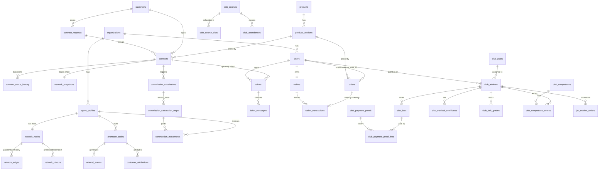

# Database Model

> **Ground truth**: this document explains the *why*. For the exact, current
> column types/constraints/indexes, see `docs/database-schema.sql` — a real
> `pg_dump --schema-only` of the live database, not hand-written. If the two ever
> disagree, trust the SQL dump and fix this file (or the SQLAlchemy models it
> drifted from). See `docs/server-migration-guide.md` for how to regenerate it.

PostgreSQL 16+. All tables carry `id UUID PRIMARY KEY` (generated client-side via
Python's `uuid.uuid4()` at insert time — not a Postgres server-side default),
`created_at TIMESTAMPTZ NOT NULL DEFAULT now()` unless noted. Money columns are
`NUMERIC(14,2)` (EUR) or integer cents (`*_cents BIGINT`) per `business-rules.md §Money`.
Every tenant-scoped table carries `organization_id UUID NOT NULL REFERENCES organizations(id)`.

This document covers the tables implemented through Phase E (the current vertical
slice). Phase F/G tables (`notifications_*`, `knowledge_*`, `ai_*`) are sketched in
`ai-architecture.md` and will be migrated when those phases start.

> **The schema is not the whole story.** After `alembic upgrade head` there are
> 85 tables (plus `alembic_version`) and no rows — and the application cannot start work without four
> families of reference data (`permissions`, `roles` + `role_permissions`,
> `ranks`, one ACTIVE `commission_plan_versions`) plus a first user. None of it
> is in `database-schema.sql`, which is `--schema-only` by design. What has to
> be there, where it comes from, and how to check it in one query:
> `docs/server-migration-guide.md` §6.1. The command that creates it for a new
> company is `python -m app.seed.bootstrap`.

## 1. Identity & tenancy

```
organizations
  id, name, legal_name, vat_number, status, settings jsonb, created_at

users
  id, organization_id, email (unique per org), password_hash,
  status (ACTIVE/FROZEN, an admin-frozen account
    that can never log in until unfrozen, see business-rules.md#account-freeze),
  email_verified_at, created_at,
  -- account gates (see business-rules.md#account-gates):
  privacy_accepted_at nullable (set once at self-registration, NULL for
    accounts that predate this field, never backfilled),
  fiscal_code nullable, residence_street/city/province/postal_code nullable,
  residence_country default 'IT' (mandatory profile-completion gate --
    retroactive for every account, unlike email verification above)

roles
  id, organization_id nullable (null = system role), code, name

permissions
  id, code (e.g. "contracts.approve"), description

role_permissions
  role_id, permission_id

user_roles
  user_id, organization_id, role_id

sessions
  id, user_id, refresh_token_hash, user_agent, ip_address,
  created_at, expires_at, revoked_at,
  replaced_by_session_id -> sessions nullable (
    set when revoked by a refresh rotation, null when by a logout -- lets a
    just-rotated token be honoured for 60 s, see security-model.md)

password_reset_tokens (same shape/reasoning as sessions:
    the opaque random token is only ever handed to the client in the reset
    link, the DB stores just its sha256 hash. Single-use (used_at) and
    time-limited (expires_at, 60 minutes). A successful reset revokes every
    active session for that user -- see auth/service.py::reset_password())
  id, user_id, token_hash, expires_at, used_at nullable, created_at

email_verification_tokens (same opaque-token/hashed-at-rest
    shape as password_reset_tokens, 24h expiry, single-use. Sent at
    self-registration only; existing accounts are grandfathered as verified,
    see users.email_verified_at and business-rules.md#account-gates)
  id, user_id, token_hash, expires_at, used_at nullable, created_at

otp_codes (short numeric code emailed for a
    self-service action a plain link-click isn't enough proof for; today
    only purpose=PROMOTER_APPLICATION_OTP_PURPOSE ("lavora con noi"),
    10-minute expiry, single-use, `purpose` keeps the table reusable)
  id, user_id, purpose, code_hash, expires_at, used_at nullable, created_at

audit_log (append-only, no updates/deletes)
  id, organization_id, actor_user_id nullable, action, entity_type, entity_id,
  previous_value jsonb, new_value jsonb, reason, ip_address, user_agent,
  correlation_id, created_at
```

## 2. Commercial network

```
agent_profiles
  id, organization_id, user_id nullable (promoters may predate a user account),
  display_name, promoter_code (unique),
  status (ACTIVE/SUSPENDED/TERMINATED/PENDING_APPROVAL -- the last one added
    both POST /network/agents (admin, org-wide) and POST
    /network/agents/recruit (a promoter enrolling their own direct
    collaborator) now only SUGGEST a new agent -- created PENDING_APPROVAL,
    unusable as a contract producer (create_contract() already rejects any
    non-ACTIVE producer, so this needed no extra guard) until approved),
  approved_by_user_id nullable, approved_at nullable (
    who/when a PENDING_APPROVAL agent was approved via PATCH
    /network/agents/{id}/approve, network.approve-gated),
  rejection_reason nullable (set by PATCH
    /network/agents/{id}/reject; a rejected agent is TERMINATED with a
    reason kept on the row, never hard-deleted, same append-only-history
    discipline as everywhere else in this project),
  photo_url nullable (profile photo, uploaded via
    POST /network/agents/{id}/photo to the public "jav-media" bucket, see
    §6 in server-migration-guide.md and core/storage.py. Same "name
    prominent, id small below" spirit -- a person recognizes a face faster
    than a promoter code),
  first_name, last_name nullable (display_name is now
    derived "first last", never edited directly; create_agent()/
    update_agent() take first_name/last_name, not display_name),
  is_blacklisted boolean default false (set via the
    admin "Blacklist" action; the ONLY case where self-service "lavora con
    noi" re-application falls back to the old manual PENDING_APPROVAL flow
    instead of auto-activating, see business-rules.md),
  collaboration_contract_version, collaboration_accepted_at,
    collaboration_otp_verified_at, all nullable ("lavora
    con noi" now requires accepting a collaboration agreement + typing back
    an emailed OTP before this row's status ever leaves PENDING_APPROVAL/
    becomes ACTIVE, see business-rules.md#account-gates and
    network/service.py::apply_as_promoter),
  joined_at

network_nodes
  id, organization_id, agent_id (unique), direct_parent_agent_id nullable,
  current_rank_id nullable, status, effective_from, effective_to nullable

network_edges                      -- redundant with network_nodes.direct_parent_agent_id
  id, organization_id, parent_agent_id, child_agent_id,        -- but kept as its own
  effective_from, effective_to nullable                        -- append-only history table

network_closure                    -- the query workhorse
  organization_id, ancestor_agent_id, descendant_agent_id, depth,
  effective_from, effective_to nullable
  PRIMARY KEY (organization_id, ancestor_agent_id, descendant_agent_id, effective_from)
  -- reflexive row required: ancestor = descendant, depth = 0
  INDEX (organization_id, ancestor_agent_id)
  INDEX (organization_id, descendant_agent_id)
  INDEX (organization_id, ancestor_agent_id, depth)
  INDEX (organization_id, descendant_agent_id, depth)

network_assignment_history
  id, organization_id, agent_id, old_parent_agent_id, new_parent_agent_id,
  requested_by, approved_by nullable, reason, effective_at, created_at

network_snapshots
  id, organization_id, reason (e.g. "contract_activation"), created_at

network_snapshot_nodes
  snapshot_id, agent_id, ancestor_agent_id, depth, rank_id_at_snapshot
  -- immutable copy of the closure rows relevant to one contract's chain at
  -- activation time; contracts reference network_snapshots.id and never the
  -- live closure table for historical commission calculations

network_change_requests
  id, organization_id, agent_id, requested_new_parent_agent_id, requested_by,
  status (PENDING/APPROVED/REJECTED), reviewed_by nullable, reason, created_at
```

**Bug fix worth knowing about**: `network/service.py::get_branch()` (the
flat descendant list the promoter tree UI builds itself from) had no `ORDER BY`
and no parent linkage -- the frontend reconstructed the tree by ASSUMING the
rows came back in pre-order traversal order, which Postgres never guarantees
for a plain `WHERE id IN (...)`. Whenever it didn't, most of the tree
silently failed to attach to its real parent, which is exactly what "only see
the first name, opening it shows nothing" looked like from the outside. Fixed
by joining `network_nodes.direct_parent_agent_id` into `BranchMemberRead` as
`parent_agent_id` (null for the branch's own root) and having the frontend
(`branch-visualizer.tsx::buildTree()`) build strictly from that field via a
map, never from row order.

`network_edges` and `network_nodes.direct_parent_agent_id` look redundant; they aren't:
`network_nodes` is the current-state pointer used for writes and simple lookups,
`network_edges` is the append-only history of every parent/child relationship that ever
held, `network_closure` is the derived, denormalized transitive-closure table maintained
transactionally whenever an edge changes. See `adr/0004-closure-table-network.md`.

## 3. Referral / attribution

```
promoter_codes
  id, organization_id, agent_id, code (unique), personal_link, qr_code_url,
  status, valid_from, valid_to nullable

referral_events
  id, organization_id, promoter_code_id, ip_address, user_agent, occurred_at

referral_sessions
  id, organization_id, promoter_code_id, cookie_token (hashed), created_at, expires_at

customer_attributions
  id, organization_id, customer_id, promoter_code_id, referral_session_id nullable,
  attributed_at
  -- Written by the public /r/{code} click-resolver and by
  -- POST /auth/register: invite-only self-registration, gated on a valid
  -- promoter_codes.code, writes exactly one customer_attributions row per new
  -- customer in the same transaction as the account itself. No schema change
  -- was needed here -- the tables were simply unused until now.

contract_attributions
  id, organization_id, contract_id, producer_agent_id, attributed_promoter_id,
  network_snapshot_id, created_at

attribution_corrections
  id, organization_id, contract_attribution_id, previous_promoter_id, new_promoter_id,
  requested_by, approved_by nullable, reason, created_at
  -- Written by admin-triggered reassignment:
  -- POST /customers/{id}/reassign-promoter (referral/service.py::
  -- reassign_customer_promoter()). Moves customer_attributions.promoter_code_id
  -- to the new promoter and writes one of these rows as the audit trail of
  -- who requested the move, from which promoter, to which, and why. A
  -- customer is never left without SOME promoter -- reassignment is
  -- rejected if there's no existing attribution to correct.
```

## 4. Catalog, customers, contracts

```
products
  id, organization_id, code,
  product_type (SERVICE/DIGITAL/PHYSICAL/SUBSCRIPTION, default SERVICE --
    SERVICE is a service sold with a contract, with a term and instalments),
  customer_type (PRIVATE/BUSINESS/BOTH -- enforced: a customer is only
    offered -- and only allowed to activate -- contracts their kind matches.
    Legacy values still parse and collapse onto BUSINESS; see
    catalog/pricing.py::normalize_product_customer_type),
  status,
  category (INTERNAL default/DROPSHIPPING/PARTNER,
    orthogonal to product_type; see §11)

product_versions
  id, product_id, version_label, base_price_cents (for a contract: the whole
    term in unica soluzione), monthly_price_cents nullable (the rata of a
    contract paid in rate, net of VAT; NULL = the rate split
    base_price_cents), initial_fee_cents,
  recurring_fee_cents, billing_period, tax_configuration jsonb (carries
    vat_percentage),
  contract_duration_months nullable (contract term length in
    months, e.g. 12 for a yearly service; NULL for a one-off
    DIGITAL/PHYSICAL product with no renewal concept. No DB/ORM-level default --
    "12 unless told otherwise" lives only in ProductCreate/ProductVersionCreate,
    so an explicit NULL from the API is never silently coerced to 12. Drives
    contracts.expires_at, see below),
  commission_plan_version_id, required_documents jsonb, terms_version,
  valid_from, valid_to nullable, status,
  credit_discount_percentage (0-100, default 0; see §11),
  cashback_enabled (bool, default false; the opt-in "+5%
    al checkout" cashback, DROPSHIPPING/PARTNER orders only; see §11),
  contract_cashback_percentage (0-100, default 0; the
    INTERNAL counterpart of cashback_enabled and a deliberately DIFFERENT
    mechanism: share of a paid contract's GROSS (VAT included) credited back
    as JavCash automatically, with NO surcharge. 0 on every product that
    exists today, so nothing changes until an admin opts in. See
    business-rules.md#cashback-modes),
  first_referrer_bonus_enabled (bool, default false) and
  first_referrer_bonus_cents (default 0): a one-off bonus
    for the promoter who ORIGINALLY brought the customer in, additive to the
    recursive commission. Configured here rather than keyed off a price or a
    product id in a controller. INTERNAL only (commissions come from
    contracts); clamped in catalog/service.py. See
    business-rules.md#first-referrer-bonus

customers
  id, organization_id, kind (PRIVATE/SOLE_PROPRIETOR/COMPANY/CONDOMINIUM),
  fiscal_code, vat_number nullable, email, phone,
  pec nullable (Italian certified email, distinct from
    the ordinary contact email),
  photo_url nullable (same reasoning as
    agent_profiles.photo_url, see §2),
  created_at

customer_profiles
  customer_id, first_name, last_name, date_of_birth

companies
  customer_id, company_name, legal_form, sdi_code

addresses
  id, organization_id, customer_id, kind, street, city, province, postal_code, country

contracts
  id, organization_id, customer_id, product_version_id,
  contract_attribution_id, network_snapshot_id, status,
  notes nullable (free-text context set at creation by
    whoever originated the deal, promoter or admin; distinct from
    contract_status_history.notes, which is per-transition, not per-contract),
  activated_at nullable (set, and reset on every renewal, by
    transition_contract() whenever the contract enters ACTIVE or RENEWED),
  expires_at nullable, indexed (activated_at +
    product_versions.contract_duration_months at that same moment; never
    recomputed retroactively if the product version's duration later changes.
    Powers the admin contract list's expiry column + year filter and the
    promoter's per-contract expiry display),
  iban nullable (the customer's bank account, as given
    in the pratica; basic format check only, `^[A-Z]{2}[0-9A-Z]{13,32}$`,
    not a full mod-97 checksum. Editable by the customer on their own
    contract or by staff on any contract),
  email nullable (contact address for THIS pratica,
    deliberately independent of the account's login email),
  holder_first_name, holder_last_name, pec -- all nullable (
    the intestatario and PEC as typed into
    the activation wizard, pre-filled from the account and freely editable;
    per contract for the same reason as email/iban. Null on older and
    staff-created contracts),

  -- Who built it. Previously only recoverable indirectly,
  -- from the actor on the first contract_status_history row.
  updated_at nullable,
  created_by_user_id nullable, created_by_role nullable (CUSTOMER/PROMOTER/
    ADMIN, snapshotted from the creator's roles -- a person's roles change,
    what they were acting as here cannot),
  activated_by_promoter_id nullable -> agent_profiles (set ONLY when a
    promoter completed the contract in place of the customer, which is
    exactly when the admin screen should say "Contratto compilato dal
    promoter X". Null when the customer did it themselves or staff created
    it -- never inferred from who earns the commission, which is the same
    promoter in the ordinary case),
  first_referrer_agent_id nullable -> agent_profiles (the promoter who
    ORIGINALLY brought this customer in, resolved from customer_attributions
    at creation and then frozen. Deliberately distinct from
    contract_attributions.producer_agent_id: reassigning the customer later
    changes who earns FUTURE business, not who is owed the bonus on a
    contract already opened),

  -- Economics, frozen at creation. Snapshot, never a live
  -- join to the product version: an admin editing a price or a VAT rate
  -- tomorrow must not restate what somebody already agreed to pay. Computed
  -- exclusively server-side by catalog/pricing.py -- no amount here ever
  -- originates from a browser. See business-rules.md#vat.
  customer_kind nullable (the buyer's kind AS IT WAS -- it is what decided
    whether VAT applies at all, so it is frozen alongside the amounts),
  net_amount_cents, vat_rate NUMERIC(5,2) (percentage points, e.g. 22.00 --
    0.00 for a private customer whatever the product's rate is),
  vat_amount_cents, gross_amount_cents, instalments_net_amount_cents,
  instalments_vat_amount_cents, instalments_gross_amount_cents (the
  same contract paid in 3/12 rate -- monthly price x months + VAT; NULL = the
  rate split the one-go price) (all nullable: a contract created
    without them keeps them NULL and is never back-filled, because
    recomputing from today's product is exactly the retroactive restatement
    the snapshot exists to prevent),

  -- Payment. Contracts are paid by bank transfer only; only an
  -- administrator confirming the money arrived marks anything paid.
  payment_plan nullable (FULL / INSTALMENTS_3 / MONTHLY_12, chosen by the
    customer when announcing the transfer; see business-rules.md#contract-payment),
  payment_method nullable (BANK_TRANSFER -- the only method),
  paid_at nullable,
  cashback_credited_at nullable (the readable exactly-once guard for the
    JavCash credit, on top of the wallet ledger's own unique idempotency
    key -- same belt-and-braces pattern as orders.cashback_credited_at),

  -- Proof of what was accepted. Stored here rather than
  -- read back through the product, so an admin replacing a contract PDF
  -- later cannot change what this customer accepted.
  terms_accepted_at, terms_accepted_by_user_id, terms_version,
  terms_accepted_ip, terms_accepted_user_agent (all nullable),
  created_at

contract_status_history
  id, contract_id, from_status, to_status, actor_user_id, reason, notes,
  correlation_id, created_at

contract_events
  id, contract_id, event_type, payload jsonb, created_at

documents (sensitive contract paperwork; see
  security-model.md for the private-storage design this table backs)
  id, organization_id, contract_id,
  document_type (IDENTITY/FISCAL_CODE/CHAMBER_OF_COMMERCE/OTHER
    -- CHAMBER_OF_COMMERCE required for COMPANY/CONDOMINIUM and merely
    offered to SOLE_PROPRIETOR; OTHER is the open slot for extra
    attachments -- see business-rules.md),
  description nullable (what the uploader called an OTHER
    attachment; always NULL for the four fixed types, which are named by
    their type),
  original_filename, storage_key (opaque, unique -- the MinIO object key in
    the private `jav-documents` bucket, never a URL),
  content_type, size_bytes,
  uploaded_by_user_id, uploaded_by_role (snapshot at upload time -- "frozen
    at the moment it happens", same pattern as network_snapshots),
  status (PENDING_REVIEW/APPROVED/REJECTED, indexed), reviewed_by_user_id
    nullable, reviewed_at nullable, review_note nullable,
  created_at
```

Contract `status` is constrained (checked in application code + a Postgres CHECK
constraint) to the state machine in `business-rules.md §Contract state machine`.

contract_commission_plans 
  id, organization_id, contract_id UNIQUE, accepted_by_user_id -> users,
  accepted_at, payment_plan nullable (known at acceptance, null if unpaid),
  total_commission_cents, preview JSONB (verbatim what the administrator was
  shown), checksum, created_at.
  -- the accepted commission preview, required before first activation;
  -- see business-rules.md#commission-preview

contract_instalments 
  id, organization_id, contract_id, number, instalments_total, due_date,
  amount_cents, status (SCHEDULED/PAID), paid_at, payment_source (ADMIN --
  an administrator confirmed the transfer), confirmed_by_user_id -> users,
  commission_event_id (the one outbox event that releases this slice),
  commission_released_at, commission_calculation_id ->
  commission_calculations, created_at. UNIQUE (contract_id, number).
  -- one row per payment owed; each paid row releases 1/N of the commissions

contract_requests 
  id, organization_id, customer_id -> customers, status (DRAFT/SUBMITTED/
  CANCELLED), holder_first_name, holder_last_name, email, pec, iban,
  created_by_user_id -> users, created_by_role, activated_by_promoter_id ->
  agent_profiles, submitted_at, cancelled_at, created_at, updated_at.
  -- la pratica: N independent contracts, shared holder/documents/payment;
  -- see business-rules.md#contract-request.

contract_requests -- address
  street, city, province, postal_code: the holder's address, asked once with
  the holder data.

contract_requests -- additions (payment by bank transfer)
  bank_transfer_requested_at, bank_transfer_total_cents (frozen: the whole
  amount, or the first instalment of every contract), bank_transfer_confirmed_at, bank_transfer_confirmed_by_user_id
  -> users, payment_proof_storage_key / _original_filename / _uploaded_at
  (optional receipt, private bucket, presigned URL)

contract_requests -- holder kind
  holder_kind nullable (PRIVATE / SOLE_PROPRIETOR / COMPANY / CONDOMINIUM:
  who the pratica's contracts are for, chosen in its data form; NULL = the
  customer's kind -- read via contracts/requests.py::pratica_kind),
  company_name, legal_rep_fiscal_code (business pratica only; the legal
  representative's name is holder_first/last_name)

contracts -- additions
  contract_request_id -> contract_requests NOT NULL (indexed).
  product_version_id is nullable, with
  CHECK ck_contracts_product_required: product_version_id IS NOT NULL OR
  status IN ('DRAFT','CANCELLED').

documents -- additions
  contract_request_id -> contract_requests nullable (indexed); contract_id is
  now nullable; CHECK ck_documents_one_owner: exactly one of the two is set.

## 5. Commissions (first-referrer bonus)

```
ranks
  id, organization_id, code, name, level, personal_token_cents,
  personal_volume_threshold_cents,
  group_volume_threshold_cents, evaluation_window_months,
  single_branch_cap_percentage, valid_from, valid_to nullable, rule_version

agent_rank_history
  id, organization_id, agent_id, rank_id, effective_from, effective_to nullable,
  calculation_source, rule_version_id, approved_by nullable, reason

commission_plan_versions
  id, organization_id, version_label, valid_from, valid_to nullable, status

commission_rule_versions
  id, commission_plan_version_id, rule_type, parameters jsonb, valid_from, valid_to nullable

commission_calculations
  id, organization_id, contract_id, network_snapshot_id, commission_plan_version_id,
  input_snapshot jsonb, output_snapshot jsonb, checksum, status, created_at

commission_calculation_steps
  id, calculation_id, step_order, beneficiary_agent_id, rank_at_calculation,
  base_amount_cents, already_distributed_cents, entrepreneurial_difference_cents,
  personal_bonus_cents, gross_amount_cents, explanation, created_at

commission_movements                                    -- the append-only ledger
  id, organization_id, agent_id, contract_id, origin_event_id, calculation_id,
  movement_type (PERSONAL_TOKEN / ENTREPRENEURIAL_DIFFERENCE /
    FIRST_REFERRER_BONUS: a one-off bonus to
    the promoter who ORIGINALLY brought the customer in, ADDITIVE to the two
    plan movements, never a replacement, and paid to a different agent than
    the producer whenever somebody else assisted that customer),
  amount_cents, currency, status, effective_date, scheduled_date nullable,
  paid_date nullable, rule_version_id, network_snapshot_id, idempotency_key (unique),
  created_at

  -- Note on idempotency_key: every other movement derives it from
  -- (contract, trigger_event, agent, type), because the recursive
  -- commission is earned again on each renewal. FIRST_REFERRER_BONUS
  -- deliberately OMITS the trigger event
  -- ("first-referrer-bonus:{contract}:{agent}"), which makes the UNIQUE
  -- constraint itself the "once per contract, ever" guarantee -- a renewal,
  -- a replayed outbox event or a manual re-run simply cannot produce a
  -- second one.

commission_adjustments / commission_offsets / commission_reversals
  id, organization_id, original_movement_id, new_movement_id, reason, requested_by,
  approved_by nullable, created_at
```

**Automatic monthly rank evaluation**:
`commissions/services/rank_evaluation.py` writes `agent_rank_history` (and,
through it, `network_nodes.current_rank_id`) on its own schedule, distinct
from every other write path above which only happens as a side effect of a
contract event. Once a month (Celery Beat, day 1 at 02:00 UTC) it recomputes
every ACTIVE agent's personal+group volume for the calendar month that just
closed and re-decides their rank against the `ranks` ladder — promoting or
**demoting** in a single step, with no rolling average. `calculation_source`
is `AUTOMATIC` for the scheduled run and `MANUAL` for an admin-triggered one
(`POST /commissions/rank-evaluation/run`). See `business-rules.md
§Automatic monthly rank evaluation` for the full rationale and
`docs/open-questions.md` for why the thresholds themselves are still
placeholders.

`product_versions.commission_tokens` (jsonb dict, default `{}`) lets one product override the org-wide
`ranks.personal_token_cents` on a per-rank-code basis (e.g.
`{"S1": 5000}`) for contracts on that product — `run_calculation.py`/
`simulate.py` look up the producing agent's rank code in this dict first,
falling back to the rank's own `personal_token_cents` when the key is
absent.

## 6. Support tickets

```
tickets
  id, organization_id, opened_by_user_id,
  opened_by_role (CUSTOMER/PROMOTER -- snapshot at creation, not derived from
    the user's current roles at read time; a later role change never rewrites
    who a past ticket "belongs to", same rule as network_snapshots),
  subject, category (ASSISTENZA_TECNICA/FATTURAZIONE/CONTRATTO/COMMISSIONI/ALTRO),
  status (OPEN/IN_PROGRESS/RESOLVED/CLOSED),
  contract_id nullable (optional link so a customer/promoter can open a ticket
    directly "about this contract"),
  created_at

ticket_messages
  id, ticket_id, author_user_id,
  author_role (CUSTOMER/PROMOTER/ADMIN -- snapshot, same reasoning as
    tickets.opened_by_role),
  body, created_at
```

Visibility: a customer or promoter sees only tickets where `opened_by_user_id` is
themselves -- there is no shared inbox between a customer and the promoter who
referred them. Staff (`tickets.respond` permission) sees every ticket in the
organization and can reply to any of them; a staff reply on an `OPEN` ticket
auto-transitions it to `IN_PROGRESS`. New permission codes: `tickets.create`
(open/read/reply to your own tickets -- granted to `CUSTOMER`, `PROMOTER`) and
`tickets.respond` (see/reply to any ticket, change status -- granted to
`ADMIN`-tier roles). See `business-rules.md §Support tickets`.

**Deletion:** a `RESOLVED` ticket (and its `ticket_messages`, no
DB-level `ondelete` cascade exists so both are removed explicitly in the
same transaction) can be permanently deleted via `tickets.delete`
(`SUPER_ADMIN`/`ORGANIZATION_ADMIN`/`ADMIN` only -- narrower than
`tickets.respond`, `BACK_OFFICE_OPERATOR` doesn't get it). See
`business-rules.md §Support tickets §Search, filter, and deletion`.

## 7. Notifications

```
notifications
  id, organization_id, recipient_user_id, created_at,
  type (CONTRACT_CREATED / TICKET_CREATED / PROMOTER_APPROVAL_REQUESTED /
    PROMOTER_APPROVED / PROMOTER_REJECTED / COMMISSION_EARNED /
    RANK_CHANGED / RANK_EVALUATION_COMPLETED / CONTACT_MESSAGE (un
    messaggio dal sito: alla segreteria del club, o agli amministratori
    della piattaforma se è scritto a JudoArteVida),
    fired by commissions/services/rank_evaluation.py: RANK_CHANGED to the
    individual agent being promoted/demoted, RANK_EVALUATION_COMPLETED as a
    roles-fanout summary to staff once a monthly run finishes),
  entity_type, entity_id (what the notification is ABOUT -- e.g. "contract"
    + a contract's uuid -- so the frontend can navigate to it),
  title, body nullable,
  is_read (default false)
```

One row per **recipient user**, not per role or per event -- `notifications/
service.py::notify_roles()` fans a single staff-facing event (new contract,
new ticket, a promoter awaiting approval) out into one row per user holding
one of the target roles at that moment, so read/unread state is tracked
correctly per person even when several admins share a role (one admin
marking a notification read must never silently clear it for a colleague).
`notify_user()` is the single-recipient case (a specific promoter earning a
commission, or being told their suggested collaborator was approved/
rejected). No dedicated permission gates `GET /notifications/mine` -- it is
self-scoped by construction (`recipient_user_id`), same pattern as
`/commissions/mine` and `/network/mine`.

Trigger points (all fire from inside the same DB transaction as the event
itself, via a plain `db.add(...)` -- no commit until the caller's own
commit, same convention as `audit_service.record()`):
`contracts/service.py::create_contract()`, `support/service.py::
create_ticket()`, `network/router.py::create_agent()`/`recruit_agent()`
(both PENDING_APPROVAL creation paths), and
`commissions/services/run_calculation.py::run_calculation_for_contract()`
(one COMMISSION_EARNED notification per beneficiary that has a linked
`user_id`, skipping agents with no login).

The frontend polls `GET /notifications/mine` every 25s (no WebSockets --
not worth the complexity for a low-volume internal tool) and maps each
notification `type` to a sidebar nav item via that item's own
`notificationTypes` array (`app-shell.tsx`), so an unread dot only ever
lights up the ONE nav entry actually relevant to it (e.g.
`PROMOTER_APPROVAL_REQUESTED` only lights up "Anagrafiche Promoter", never
"Tutti i Contratti").

## 8. Documentation / news feed

```
documentation_posts
  id, organization_id, created_by_user_id,
  title, body nullable (plain text, not HTML/markdown -- rendered with
    whitespace preserved),
  audience (CUSTOMER / PROMOTER / BOTH -- no "internal staff" option, this
    feed is for the two customer-facing roles only),
  status (PUBLISHED / ARCHIVED -- soft-hide, same pattern as
    AgentProfile.status; a real DELETE is a separate, permanent admin action),
  image_url / pdf_url / pdf_filename / video_url, all nullable and
    independent -- a post can be text-only or carry any combination,
  created_at, updated_at
```

Admin-authored posts (announcements, training material) published to one or
both dashboards, gated by `documentation.manage` (same permission tier as
`products.manage`: `SUPER_ADMIN`/`ORGANIZATION_ADMIN`/`ADMIN`). Read-only for
customers/promoters — `documentation-feed.tsx` filters client-side to
`PUBLISHED` posts matching the viewer's own role. Attachments live in the
public `jav-media` bucket (marketing material, not the sensitive-document
workflow in §4/`documents`), uploaded via
`core/storage.py::upload_documentation_attachment()`.

## 9. Internal wallet

**"JavCash"**: purely a UI label, not a schema/domain change --
every `wallets`/`wallet_transactions` amount is still `balance_cents`/
`amount_cents` in the same table, same currency (`EUR` string, unchanged).
The dashboard (customer- and admin-facing) formats every wallet balance and
transaction amount with a `JavCash` suffix instead of a euro sign, to keep
it visually distinct from the *real* money columns on `orders`, contracts
and club fees (paid by bank transfer, always shown in actual EUR). See `business-rules.md#internal-wallet`.

```
wallets
  id, organization_id, user_id (unique -- one wallet per login, whether
    CUSTOMER, PROMOTER, or both roles on the same account),
  address (unique, "0x" + 40 hex chars, Ethereum-style -- cosmetic
    resemblance only, no real blockchain involved),
  balance_cents (BigInteger, default 0, CHECK >= 0 -- the first CHECK
    constraint anywhere in this codebase, justified because this is the
    first column that is real financial state rather than an append-only
    ledger total),
  currency (default EUR),
  can_transfer (Boolean, default FALSE; peer-to-peer
    sending is denied by default for every wallet and enabled individually
    per promoter by an admin, PATCH /wallets/admin/{user_id}/transfer-
    permission. Deliberately per-wallet, not a role grant.)

wallet_transactions                                     -- the ledger
  id, organization_id,
  from_wallet_id nullable (NULL = admin/system origin, i.e. an ADMIN_CREDIT),
  to_wallet_id nullable (NULL = admin/system destination, i.e. a REVERSAL
    of an ADMIN_CREDIT, or a PURCHASE_DEBIT -- CHECK ensures at least one
    side is set),
  amount_cents, currency,
  type (ADMIN_CREDIT / TRANSFER / PURCHASE_DEBIT / REVERSAL, the mirror of ADMIN_CREDIT: to_wallet_id
    NULL instead of from_wallet_id NULL, money leaves a wallet to pay for an
    order and ceases to exist),
  source nullable (
    MANUAL_ADMIN / WELCOME_BONUS / ORDER_CASHBACK_BASE / ORDER_CASHBACK_BONUS /
    CONTRACT_CASHBACK, a structured tag distinguishing WHY an ADMIN_CREDIT
    row exists without parsing free-text `note`; NULL for
    TRANSFER/PURCHASE_DEBIT/REVERSAL, where `type` alone already says
    enough. CONTRACT_CASHBACK is deliberately its own value
    rather than reusing ORDER_CASHBACK_BASE: the order opt-in 5% and the
    surcharge-free automatic credit on a paid contract are different
    business rules, and accounting has to be able to tell them apart at a
    glance. See business-rules.md#cashback-modes),
  reference_contract_id nullable (links a cashback credit to the purchase
    that triggered it -- always NULL for TRANSFER/REVERSAL),
  reference_order_id nullable,
  reference_jav_market_order_id nullable (FK jav_market_orders.id -- the
    Shop order a PURCHASE_DEBIT paid, or its REVERSAL refunded),
  reverses_transaction_id nullable (self-FK, set only on a REVERSAL row --
    the original row is never mutated, same discipline as
    CommissionReversal in §5),
  note nullable, actor_user_id nullable, idempotency_key (unique)
```

ONE ROW per transaction (not double-entry with two rows) -- deliberate,
simpler schema matching the user's own framing ("una tabella globale delle
transazioni... ogni transazione è associato a id cliente e id ricevente").
`Wallet.user_id` is the only ownership key -- not `Customer.id` or
`AgentProfile.id` specifically, since a person may hold both roles on the
same login (see `network/service.py::apply_as_promoter`); the wallet is
created lazily on first access (`wallets/service.py::get_or_create_wallet()`).

**Concurrency**: a debit (peer transfer, or a reversal clawing money back)
uses an atomic compare-and-swap `UPDATE ... WHERE balance_cents >= :amount`
and checks the affected row count -- not `SELECT ... FOR UPDATE`, this
codebase's only other concurrency pattern anywhere being a DB unique
constraint + catching `IntegrityError` (see `commission_movements
.idempotency_key`). `idempotency_key` (a deterministic or client-generated key)
guards against a double-submitted request creating two transactions.

**Reversal**: admin-only (`wallet.manage`, same tier as `SUPER_ADMIN`/
`ORGANIZATION_ADMIN`/`ADMIN` -- not `BACK_OFFICE_OPERATOR`), inserts a new
`REVERSAL` row rather than mutating the original. Reversing a `TRANSFER`
re-debits the original recipient, which can itself fail with
`InsufficientBalanceError` if they've since spent the funds -- an accepted,
documented outcome. Reversing a `PURCHASE_DEBIT` just
credits the buyer back -- there is no recipient wallet to claw back from,
the mirror-image case `reverse_transaction()` was extended to handle
correctly. A `REVERSAL` itself can never be reversed.

No real-money withdrawal or payment-provider integration exists or is
planned for this domain -- it is a purely internal, virtual balance.

## 11. Product credit categories & orders

```
products (extended)
  category (INTERNAL default / DROPSHIPPING / PARTNER -- orthogonal to
    product_type, which describes WHAT a product is, not who supplies it or
    how it may be paid)

product_versions (extended)
  credit_discount_percentage (0-100, default 0 -- how much of THIS
    version's price the checkout may let a customer pay from wallet credit
    instead of bank transfer. Enforced server-side to stay 0 whenever the
    parent product's category is INTERNAL, regardless of what's requested --
    catalog/service.py::_clamp_credit_discount() is the single place this
    is enforced, including when a product's category is changed back to
    INTERNAL after having a discount configured, which zeroes it on every
    version in one bulk update.)
  cashback_enabled (Boolean, default false. Whether the
    checkout may offer "riscuoti subito cashback" on THIS version at all.
    Same INTERNAL-forced-false invariant and same single-enforcement-point
    pattern as credit_discount_percentage above --
    catalog/service.py::_clamp_cashback_enabled().)

orders                                    -- DROPSHIPPING/PARTNER purchases
  id, organization_id,
  customer_user_id (FK users.id -- whose wallet is debited),
  product_version_id (FK product_versions.id),
  created_by_user_id (FK users.id -- an admin, OR the customer themselves
    for a self-checkout order -- POST /orders/mine forces
    this to equal customer_user_id, same rule as wallet transfer's
    from_wallet_id),
  amount_cents (frozen from product_version.base_price_cents at creation --
    same "frozen at the moment it happens" rule as everywhere else),
  credit_applied_cents (default 0, CHECK 0 <= credit_applied_cents <=
    amount_cents),
  credit_debit_transaction_id nullable (FK wallet_transactions.id -- set
    only when credit_applied_cents > 0, points at the PURCHASE_DEBIT row so
    cancelling can reverse that exact row rather than minting a fresh,
    less-traceable refund),
  cashback_requested (Boolean, default false, "riscuoti
    subito cashback" opted in at checkout; only permitted when the
    product_version has cashback_enabled AND the residual after credit is
    > 0, see orders/service.py::create_order),
  cashback_surcharge_cents (BigInteger, default 0,
    ORDER_CASHBACK_PERCENTAGE (5%) of the residual owed in new money,
    frozen at order creation same as amount_cents),
  cashback_credited_at nullable (set once
    _credit_order_cashback() has run for this order -- doubles as the
    idempotency guard against a repeated confirmation double-crediting),
  status (AWAITING_PAYMENT / PAID / CANCELLED),
  payment_method (BANK_TRANSFER -- the only method; irrelevant when
    credit_applied_cents covers 100% of amount_cents),
  payment_proof_storage_key/payment_proof_original_filename/
    payment_proof_uploaded_at nullable -- customer-uploaded evidence of a
    bank-transfer payment already sent, purely advisory (never changes
    `status` by itself), reuses core/storage.py's private documents bucket
    directly under an `order-payment-proofs/{customer_user_id}/` prefix
    (never the `documents` domain, whose contract_id is NOT NULL by
    design).
  note nullable,
  paid_by_user_id/paid_at nullable (the administrator who confirmed the
    transfer), cancelled_by_user_id/
    cancelled_at/cancellation_reason nullable
```

**"Riscuoti subito cashback"**: when the customer opts in at
checkout (only offerable on a `cashback_enabled` product version), the
residual owed in new money gets a flat `ORDER_CASHBACK_PERCENTAGE` (5%)
surcharge. Once the order reaches `PAID` -- bank transfer admin-confirmed
-- `orders/service.py::_credit_order_cashback()`
credits the customer's wallet with the base amount actually paid PLUS the
5% bonus, as two separate `wallet_transactions` rows
(`ORDER_CASHBACK_BASE`/`ORDER_CASHBACK_BONUS`, never one combined row).
**Security
invariant**: the cashback base is always computed from `amount_cents -
credit_applied_cents` -- the actual new money owed AFTER any wallet-credit
discount was already applied, never the pre-discount price -- so a
customer can never manufacture credit by first paying with credit and then
having cashback computed off a higher, unpaid base. Idempotency is a
double guard: the `cashback_credited_at` column on the order, plus
deterministic (non-client-supplied) idempotency keys
(`order:{id}:cashback-base|bonus`) on the two `credit_wallet()` calls.

**Spending existing wallet credit now requires an OTP**: at
self-checkout (`POST /orders/mine`), if `credit_applied_cents > 0` the
request must also carry a fresh `otp_code`, emailed via
`POST /orders/mine/request-credit-otp` (`WALLET_CREDIT_SPEND_OTP_PURPOSE`,
reusing the platform's existing generic OTP infrastructure --
`auth/service.py::request_otp`/`verify_otp`). An admin creating an order on
a customer's behalf (`POST /orders`, `wallet.manage`-gated) is exempt --
the OTP would land in the customer's inbox, not the admin's, and the
action is already permissioned and audited.

Deliberately **not** an extension of `Contract` -- a contract carries a
term, documents, approval and commissions that a one-off purchase has no
use for; a separate, much simpler domain was the lower-risk choice. If
`credit_applied_cents` covers 100% of `amount_cents` at creation, the order
skips straight to `PAID` -- no bank transfer, no `AWAITING_PAYMENT` step. Cancelling an
`AWAITING_PAYMENT` order reverses the exact `credit_debit_transaction_id`
row (see §9's `PURCHASE_DEBIT` reversal) before marking itself `CANCELLED`,
refunding the customer precisely.

**Self-checkout**: `POST /orders/mine`, `GET /orders/mine`,
`GET /orders/quote/mine`, `POST /orders/mine/{id}/payment-proof` are all
open to any authenticated user -- no permission beyond authentication,
`customer_user_id` always the caller's own id. `create_order()` validates
the requested `payment_method` only when a residual exists, and only
accepts one that's actually configured for the organization (see §12) --
`PaymentMethodNotAvailableError` otherwise, which is what makes "the button
doesn't even render if unconfigured" a real guarantee rather than just a
frontend nicety.

## 12. Organization settings

No new table -- `organizations.settings` (JSONB) is read/written through a
typed subset: `GET`/`PATCH /organizations/me/settings` (`organization.manage`
permission -- SUPER_ADMIN/ORGANIZATION_ADMIN/ADMIN) holds
`bank_iban`/`bank_account_holder`/`bank_transfer_instructions` (the account
and free-text instructions customers wire bonifico payments to),
`admin_notification_email` (where the "new ticket opened" alert email goes,
`organizations/service.py::get_admin_notification_email`, defaults to
`admin@example.com` when unset) and `contract_instalment_cashback_mode`. The
PATCH merges into the existing dict (`{**org.settings, **updates}`, only
fields actually present), so an unrelated key living in the same JSONB blob
is never clobbered. `GET /organizations/me/payment-info` exposes **only**
IBAN, holder and instructions to any signed-in user -- what a customer
needs to pay, never the rest of the settings.

## 13. ER diagram (core slice)



Full ER diagram will grow as Phase F/G tables land; kept mermaid so it renders directly
wherever this doc is viewed.

## 14. Accounting view

**No new table.** `GET /accounting/mine` (`accounting/service.py::
list_my_movements`) computes a unified, read-only, newest-first feed of a
user's own financial activity purely by querying two existing sources and
merging them in Python -- deliberately not a materialized/persisted table,
so there is nothing here that can drift from `wallet_transactions`/`orders`,
which remain each domain's own single source of truth:

- Every `wallet_transactions` row touching the caller's own wallet (both
  in/out), formatted as a `"WALLET"` / `"JAVCASH"` movement, signed
  (negative = money left the wallet). Product name resolved via
  `reference_order_id` when set.
- Every one of the caller's own `PAID` `orders` where real money was
  actually charged (`amount_cents - credit_applied_cents +
  cashback_surcharge_cents > 0`), formatted as an `"ORDER_PAYMENT"` /
  `"EUR"` movement carrying `payment_method`. An order fully covered by
  wallet credit produces no row here at all -- that spend is already shown
  as its own `WALLET` row.

This is what the customer-facing "Contabilità" dashboard section renders
(filters by JavCash/Bonifico, totals, CSV export) -- see
`business-rules.md#internal-wallet`.

Still no new table: a third real-money source, every `PAID`
`contract_instalments` row as a `"CONTRACT_PAYMENT"` / `"EUR"` movement
(`contract_id`, `contract_request_id`, `payment_method` always
`BANK_TRANSFER`); `GET /accounting/mine/summary` (totals, next instalment,
commissions from `commission_movements` for a promoter) and
`GET /accounting/{mine,admin}/detail?ref=` (read-only detail with timeline)
are computed from the existing tables. See
`business-rules.md#accounting-detail`.

## 16. "Invita un amico"

Three tables that are **deliberately a parallel structure**, not an extension
of the commercial network -- see `business-rules.md#friend-referrals` for the
rules. One level, no hierarchy, no commissions.

```
friend_referral_codes
  id, organization_id, user_id (UNIQUE), code (UNIQUE, "INV-XXXXXXXX" --
    resolution matches the whole code, never the prefix),
  status, created_at

  -- Separate from promoter_codes on purpose. That table means "this agent
  -- earns commissions on what comes through here" and is wired into
  -- attribution, the tree and the commission engine; this one means nothing
  -- more than "this person shared a link". Overloading promoter_codes with
  -- codes that pay nobody would have made every existing query about
  -- promoter codes subtly wrong.

friend_referrals
  id, organization_id, referrer_user_id (index),
  referred_customer_id (UNIQUE -- one person can only ever have been brought
    in by one other), code_used, source (PROMOTER_LINK/FRIEND_LINK),
  created_at

  -- No activated_at column, deliberately: "attivo" is derived from the
  -- referred customer's contracts at read time. A stored flag would need an
  -- event hook on every path that can activate, renew or cancel a contract,
  -- and the first one anybody forgot would leave the count permanently wrong
  -- with nothing to reconcile it against.

friend_referral_reward_claims
  id, organization_id, referrer_user_id (index), milestone (5/10/15...),
  status (REQUESTED/FULFILLED/REJECTED, index), handled_by_user_id,
  handled_at, note, created_at
  UNIQUE (referrer_user_id, milestone)

  -- That UNIQUE is what makes "un omaggio ogni 5" exact: milestone 5 can be
  -- requested once, ever, whatever the count does afterwards. Repeatable at
  -- every multiple of 5, explicitly not only the first. Not an automatic
  -- payout: the gift (today "una gift card da 25 euro", see
  -- friend_referrals/models.py::REWARD_DESCRIPTION) is handed over by a
  -- human, who records what was given in `note`.
```

**This structure never decides who gets paid.** Where an invited customer
lands in the commercial tree is still entirely `referral` + `network`: a
promoter's link puts them in that promoter's tree; a plain customer's link
puts them under that customer's own promoter. There is exactly one
`CustomerAttribution` per registered customer either way, and these three
tables could be dropped without changing a single euro of commission.


## 17. PIN dei JavCash

Tabella `spend_pins` (dominio `auth`): una riga per utente (`user_id`
UNIQUE), `enabled`, `pin_hash` (stesso hash della password, NULL quando il
cliente torna all'email), `failed_attempts` e `locked_until` per il blocco
dopo 5 errori. Nessuna riga = codice via email. Tabella a parte e non
colonne su `users`: il PIN riguarda il denaro, non l'anagrafica.

## 18. Lo Shop: «Fai la Spesa con Jav»

Dominio `domains/jav_market`. Sette tabelle: `jav_market_settings` (una riga
per organizzazione: acceso, spedizione, `auto_forward`, ordine minimo e
soglia di spedizione gratuita, `supplier_email_from` e
`supplier_email_signature` per le email ai fornitori), `jav_market_producers`
(**l'azienda che produce**, il fornitore, UNIQUE sul nome per
organizzazione), `jav_market_products` + `jav_market_variants` (il catalogo
scritto a mano, varianti = taglie, `producer_id` nullable),
`jav_market_orders` + `jav_market_order_items` (ordini nativamente
multi-riga, con `producer_name` e `producer_id` congelati sulla riga) e
`jav_market_supplier_dispatches`.

Sulla riga d'ordine (migrazione 0003): `producer_id` nullable → il
fornitore risolto alla creazione (del prodotto o della sua categoria);
`supplier_dispatch_id` nullable → l'email con cui la riga è partita, NULL =
ancora da mandare. È questa colonna, non un flag sull'ordine, a dire cosa
resta da avvisare.

**`jav_market_supplier_dispatches`** — un'email **partita** verso un
fornitore: `organization_id`, `producer_id`, `source` (CHECK `QUEUE` dalla
coda «Fornitori da avvisare», `ORDER` dal pulsante sull'ordine, `AUTO`
invio automatico, `LEGACY` invii fatti prima della 0003), `to_email`,
`subject`, `body_text` (il testo esatto, anche se corretto a mano),
`sent_at`, `sent_by_user_id` (NULL per l'automatico). Un invio fallito non
lascia righe. La 0003 riempie `producer_id` delle righe esistenti dal
prodotto e crea un invio `LEGACY` per (ordine già inoltrato, fornitore).

Sull'ordine: `forwarded_at` / `forwarded_by_user_id` / `forward_error` per
l'invio alle aziende produttrici; `vat_mode` (`INCLUDED`/`ADDED`) e
`vat_percentage`/`vat_amount_cents` congelati alla creazione (aliquota in
`organizations.settings.marketplace_vat_percentage`, default 22);
`athlete_id` nullable → `club_athletes`, l'atleta per cui è l'ordine.
**Tutto il denaro resta sulla testata** (importo, spedizione, IVA, JavCash).

Il numero d'ordine viene dalla sequenza `shop_order_number_seq` (START 1000,
dichiarata in `domains/marketplaces/models.py` così `create_all` la
costruisce anche nei test; creata a mano nella migrazione iniziale, perché
autogenerate non crea le sequenze): una sequenza non salta e non duplica
nemmeno con due inserimenti simultanei.

`wallet_transactions.reference_jav_market_order_id` collega addebito JavCash
e rimborso all'ordine.

## 19. Il carrello

Dominio `domains/carts`.

**`carts`** — `organization_id`, `customer_user_id`, `shop`
(`jav_market|catalog`), con `UNIQUE(customer_user_id, shop)`: un carrello
aperto per cliente e per negozio. È quel vincolo a rendere idempotente
l'aggiunta al carrello, senza flag applicativi. Non si cancella dopo
l'acquisto, si svuota, così l'id resta stabile.

**`cart_items`** — `cart_id`, `quantity` (1..99) e un **arco esclusivo** di
due chiavi esterne nullable: `jav_market_variant_id` e `product_version_id`.
Il CHECK `num_nonnulls(...) = 1` impone che ne sia valorizzata esattamente
una; due `UNIQUE(cart_id, <colonna>)` separati, perché in PostgreSQL due NULL
sono distinti. Le chiavi esterne restano vere: una variante cancellata si
porta via in CASCADE le righe di carrello che la citano.

**Nel carrello non ci sono prezzi**: solo cosa e quanto. Ogni lettura li
ricalcola dal listino di quel momento (CLAUDE.md §5).

## 20. Categorie degli shop

Dominio `domains/shop_categories`.

- `shop_categories`: `organization_id`, `shop` (`internal|partner|
  dropshipping|jav_market`), `name`, `position`, `active`, `producer_id`
  nullable (FK `jav_market_producers` ON DELETE SET NULL, solo per
  `shop = jav_market`: il fornitore ereditato dai prodotti senza un
  fornitore loro). Indice unico funzionale su `(organization_id, shop,
  lower(name))`.
- `shop_category_products`: `category_id` (FK ON DELETE CASCADE), `shop`,
  `product_id` **UUID senza FK** — polimorfico, punta a `products` o
  `jav_market_products` a seconda di `shop`. Unico `(category_id,
  product_id)`, indice `(organization_id, shop, product_id)`.
- Nessuna colonna aggiunta alle tabelle dei prodotti.

## 21. Club (`domains/club`)

Specifica e regole: `club-portal.md`. Tutte le tabelle hanno
`organization_id`; quelle che portano dati di un club anche `club_id`
(NOT NULL, indicizzato): piani, atleti, quote, prove, certificati, cinture,
corsi, presenze, gare, iscrizioni. Le tabelle figlie senza `club_id`
(`club_course_slots`, `club_course_athletes`, `club_payment_proof_fees`)
ereditano il club dalla riga a cui appartengono.

```
clubs                      i club della piattaforma (migrazione 0002)
  name, slug (UNIQUE per organizzazione, solo [a-z0-9-]: è l'indirizzo
  /c/<slug> di registrazione delle famiglie), status (ACTIVE/SUSPENDED),
  settings JSONB (bank_iban, bank_account_holder,
  bank_transfer_instructions, contact_email: le coordinate delle quote)

users.club_id -> clubs     nullable: il club dell'account (genitore,
                           segreteria, istruttore); NULL per lo staff della
                           piattaforma, che entra nei club scegliendoli

club_plans                 piani di iscrizione per fascia d'età
  name, min_age, max_age nullable, monthly_fee_cents, enrollment_fee_cents,
  due_day (1-28), billing_months SMALLINT[] (default set-giu), active

club_athletes              i figli (o il genitore stesso, is_self)
  guardian_user_id -> users, first_name, last_name, birth_date, sex (M/F),
  fiscal_code, photo_url, is_self, plan_id -> club_plans, plan_locked,
  status (ACTIVE/SUSPENDED/LEFT), weight_kg, federation_number,
  federation_expires_on

club_fees                  le quote
  athlete_id, kind (MONTHLY/ENROLLMENT/COMPETITION), period, amount_cents
  (congelato), due_date, status (DUE/PAID/WAIVED), ...
  UNIQUE (athlete_id, kind, period) -- l'idempotenza dei job

club_fees (0004)           + guardian_user_id (quota socio MEMBERSHIP, senza
                           atleta: UNIQUE parziale club+genitore+anno),
                           gross_amount_cents, discount_cents, discount_note
                           (listino e sconti congelati)
club_athletes (0004)       + social_tier (A/B/C), adapted_judo
club_competitions (0004)   + kind (COMPETITION/STAGE), transport_needed,
                           transport_entity_name/_email, transport_departure,
                           transport_return, transport_companions,
                           transport_notes, transport_auto_send
club_transport_requests    la lettera del trasporto, una per evento (UNIQUE
                           competition_id): to_email, subject, body_text,
                           status DRAFT/SENT, athletes_count, sent_at, last_error
wallet_transactions (0004) + reference_club_proof_id: il credito usato per le
                           quote

club_payment_proofs        la foto/PDF del bonifico (bucket privato);
                           + credit_cents (0004), file facoltativo se il
                           credito copre tutto
  status (ACCEPTED/REJECTED), reviewed_by_user_id, rejection_reason, ...
club_payment_proof_fees    quali quote copre una prova
  UNIQUE (proof_id, fee_id)

club_fees (0014)           + payment_method (BANK_TRANSFER/CASH/CARD/WALLET,
                           CHECK, NULL se da pagare), cash_received_by_user_id
                           -> users, cash_received_by_name (congelato)
club_payment_proofs (0014) + method (BANK_TRANSFER/CASH, default
                           BANK_TRANSFER), cash_received_by_user_id -> users,
                           cash_received_by_name; CHECK file_or_credit ora
                           "file, o credito che copre tutto, o contanti";
                           CHECK cash_receiver (i contanti dicono a chi)
club_school_letters (0014) la giustificazione per la scuola di un iscritto
  entry_id -> club_competition_entries (UNIQUE), competition_id, athlete_id,
  body_text (il testo stampato), storage_key (PDF nel bucket privato),
  generated_at, generated_by_user_id

club_medical_certificates  type (AGONISTIC/NON_AGONISTIC), issued_on,
                           expires_on, file nel bucket privato
club_belt_grades           storico cinture, UNIQUE (athlete_id, grade);
                           la cintura attuale è la più alta, mai una colonna

club_courses, club_course_slots (weekday 0-6, orari), club_course_athletes
  UNIQUE (course_id, athlete_id)
club_attendances           UNIQUE (athlete_id, course_id, date)

club_competitions          level (CLUB/REGIONAL/NATIONAL/INTERNATIONAL),
                           date, scadenza iscrizioni, quota, età min/max,
                           requires_agonistic_certificate,
                           status (OPEN/CLOSED/DONE)
club_competition_entries   UNIQUE (competition_id, athlete_id), category,
                           status (REGISTERED/WITHDRAWN), placement
                           (1/2/3/5/7, 0 = partecipazione)

club_reminders_sent        UNIQUE (kind, entity_id, stage) -- un avviso
                           una volta sola per gradino
```

Il Jav Ranking, il livello, i punti esperienza e le medaglie di un atleta
**non hanno tabelle**: si calcolano da risultati, presenze e cinture a ogni
lettura (`club/competitions.py`, `club/achievements.py`).

## 22. Sito pubblico JudoArteVida (`club/site_models.py`, `club/contact_models.py`, migrazioni 0006, 0010 e 0011)

Ciò che il sito pubblico mostra sta in **tabelle sue**, separate dai dati del
gestionale: una query del sito non può trascinarsi dietro per sbaglio una
data di nascita o un codice fiscale. Regole in `docs/club-portal.md`, "Sito
pubblico".

```
club_sites                       la pagina pubblica di un club, una per club
  organization_id, club_id -> clubs UNIQUE, tagline, about (TEXT), city,
  hero_image_url, logo_url (bucket media pubblico),
  gallery JSONB [{url, caption}] (max 24), coaches JSONB [{name, role,
  photo_url}] (scritti a mano, max 12), contact_phone, contact_email,
  address, map_url, instagram_url, facebook_url, youtube_url, website_url,
  published (default false), show_prices (default false, migrazione 0008:
  il club sceglie se JAVBOT del sito può dire i prezzi dei suoi piani),
  brand_primary, brand_secondary, brand_accent (VARCHAR 7, migrazione
  0011: i colori della pagina, "#RRGGBB" maiuscolo o NULL = colori di
  JudoArteVida; un CHECK per colonna `~ '^#[0-9A-F]{6}$'`),
  updated_at
  -- un club è sul portale solo se clubs.status = ACTIVE e published
  -- facebook_url / instagram_url / youtube_url: solo https verso il loro
     sito (site.check_social_url); hero_image_url è la copertina

club_athlete_public_profiles     consenso della famiglia e scelta del club
  organization_id, club_id, athlete_id -> club_athletes UNIQUE,
  consent_given_at (NULL = nessun consenso: mai dato o ritirato),
  consent_by_user_id -> users (chi ha deciso, anche il ritiro),
  show_photo (consenso a parte per la foto), bio (280),
  published (la scelta del club; vale solo con il consenso),
  ijf_profile_url (300; solo www.ijf.org/judoka/<id> o JudoBase
  competitor/profile/<id>, https), favorite_technique (80),
  dominant_side (LEFT | RIGHT | NULL) -- migrazione 0010, scritti dalla
  segreteria per la scheda del judoca

club_athlete_media               foto e video della scheda del judoca (0010)
  organization_id, club_id -> clubs, athlete_id -> club_athletes,
  kind (PHOTO | VIDEO), url (la foto, bucket media pubblico), youtube_id
  (11 caratteri: del video si salva solo l'id, mai un indirizzo),
  caption (200), published (default false: ogni elemento si pubblica a
  parte), created_by_user_id -> users, created_at
  -- CHECK: PHOTO ha url e niente youtube_id, VIDEO il contrario
  -- UNIQUE (athlete_id, youtube_id): lo stesso video una volta sola
  -- massimo 24 foto e 12 video per atleta (limite del servizio)
  -- sul sito solo published, del club attuale dell'atleta, e solo se
     show_photo è vero; ritirare il consenso li rimette tutti a false
```

```
contact_messages                 i messaggi scritti dal sito (0011): non
                                 pubblici, li legge solo chi li riceve
  organization_id, club_id -> clubs (NULL = scritto a JudoArteVida da
  /contactos), name (120), email (255), phone (40, facoltativo),
  message (TEXT, 10–4000 caratteri), locale (pt | it | en, default pt),
  status (NEW | READ | ARCHIVED, CHECK, default NEW), consent_at (quando
  ha spuntato il consenso a essere ricontattato: senza, il messaggio non
  si salva), ip_hash (64: sha256 dell'IP con il segreto del server, mai
  l'IP), user_agent (200), emailed_at (NULL = l'email di avviso non è
  partita: SMTP non configurato, nessun indirizzo, server giù), created_at
  -- INDEX (ip_hash, created_at): il tetto di 5 messaggi l'ora per mittente
  -- la segreteria vede solo club_id = il suo club (club/scope.py); quelli
     con club_id NULL solo lo staff della piattaforma (clubs.enter, account
     senza club); i messaggi dei club nella console solo con clubs.manage
```

Orari, gruppi, eventi, risultati, punti, medaglie, posto nel ranking,
percorso delle cinture, prove in programma e il tema dei colori del sito
**non hanno tabelle**: si leggono da piani, corsi, gare, risultati e storico
delle cinture del club a ogni richiesta (il tema lo calcola `club/brand.py`
dai tre colori).

## 23. JAVBOT (`domains/javbot`, migrazioni 0008 e 0015)

L'assistente dell'area privata. Legge i dati degli altri domini attraverso
i loro servizi; qui tiene solo la conversazione e le azioni che aspettano un
"sì". Regole in `docs/club-portal.md`, "JAVBOT". Il bot del sito pubblico
non ha tabelle: è senza stato.

```
javbot_conversations             una conversazione di un utente in un club
  organization_id, user_id -> users, club_id -> clubs (NULL fuori dai club),
  state JSONB (la memoria corta del pianificatore: percorso in corso,
  domanda in sospeso, compito da confermare), created_at, updated_at

javbot_messages                  le battute, nell'ordine
  conversation_id -> javbot_conversations ON DELETE CASCADE, user_id,
  club_id, role (user | bot), text, actions JSONB (i bottoni), quick_replies
  JSONB, intent (l'intenzione riconosciuta, sulle battute dell'utente),
  created_at
  -- indice (conversation_id, created_at)

javbot_tasks                     ciò che JAVBOT farà solo dopo un "sì"
  organization_id, conversation_id -> javbot_conversations ON DELETE CASCADE,
  user_id, club_id, kind (SHOP_ORDER | CLUB_MESSAGE | MARK_ATTENDANCE),
  payload JSONB (tutto ciò che serve a eseguirlo: variante, atleta,
  indirizzo, testo), status (PENDING | DONE | CANCELLED),
  result_ref UNIQUE (l'id dell'ordine creato), done_at, created_at
  -- la conferma "prende" il compito con UPDATE ... WHERE status = 'PENDING'
     nella stessa transazione dell'esecuzione: una seconda conferma non
     esegue niente. Una proposta vale 30 minuti.
```

Conservazione: una conversazione ferma da più di 90 giorni si cancella (con
battute e compiti) la volta successiva che lo stesso utente apre JAVBOT.

**La base di conoscenza** (migrazione 0015, `javbot/knowledge.py`): i PDF
che l'assistente dell'area riservata consulta e le istruzioni scritte da chi
amministra. `club_id` NULL = la base comune a tutti i club.

```
javbot_knowledge_documents       un PDF caricato
  organization_id, club_id -> clubs (NULL = comune), title, filename,
  storage_key (bucket privato), size_bytes, page_count, char_count,
  status (READY | EMPTY: senza testo), uploaded_by_user_id -> users,
  created_at

javbot_knowledge_chunks          il testo del PDF a pezzi
  document_id -> javbot_knowledge_documents ON DELETE CASCADE,
  organization_id, club_id -> clubs ON DELETE CASCADE (ripetuto dal
  documento: la ricerca filtra senza JOIN), ordinal, page (da 1), text,
  norm (minuscolo, senza accenti)
  -- indice GIN su to_tsvector('simple', norm)

javbot_instructions              il prompt di chi amministra
  organization_id, club_id -> clubs ON DELETE CASCADE (NULL = comune),
  text, updated_at, updated_by_user_id -> users, created_at
  -- UNIQUE (club_id) WHERE club_id IS NOT NULL; UNIQUE (organization_id)
     WHERE club_id IS NULL: una riga comune, al più una per club
```

## 24. Contabilità del club (`club/models.py`, migrazione 0007)

Solo i fatti che non si ricavano da altro. Incassi, debiti, costo dello
staff, commissione della piattaforma e risultato **non hanno tabelle**: si
calcolano da quote, prove, cartellino e ordini a ogni lettura
(`club/accounting.py`). Regole in `docs/club-portal.md`, "Contabilità".

```
club_expenses                    una spesa del club
  organization_id, club_id, spent_on, category (RENT/STAFF/FEDERATION/
  INSURANCE/EQUIPMENT/TRANSPORT/EVENTS/UTILITIES/MARKETING/ADMIN/OTHER),
  amount_cents > 0, description, supplier, payment_method (BANK_TRANSFER/
  CASH/CARD/DIRECT_DEBIT/OTHER), receipt_storage_key / receipt_filename /
  receipt_content_type (bucket privato documenti), created_by_user_id,
  recurring_id -> club_recurring_expenses, period (YYYY-MM)
  -- UNIQUE (recurring_id, period): il job dei costi fissi è idempotente
  -- CHECK (recurring_id IS NULL) = (period IS NULL); indice (club_id, spent_on)

club_recurring_expenses          un costo fisso mensile
  organization_id, club_id, category, amount_cents > 0, description,
  supplier, payment_method, day_of_month (1-28), starts_on, ends_on
  (NULL = finché non si ferma, >= starts_on), active, created_by_user_id

club_staff_rates                 la tariffa oraria di chi timbra, da una data
  organization_id, club_id, user_id -> users, hourly_rate_cents >= 0,
  valid_from, set_by_user_id
  -- UNIQUE (club_id, user_id, valid_from); vale la più recente <= il giorno
     del turno

club_platform_fees               la percentuale degli incassi alla piattaforma
  organization_id, club_id, pct NUMERIC(5,2) 0-100, valid_from (sempre il
  primo del mese, CHECK), set_by_user_id
  -- UNIQUE (club_id, valid_from); senza righe vale il 10%; la scrive solo
     il superadmin (clubs.manage)
```

## 25. Cursos JAV (`club/kinds.py`, migrazione 0009)

I corsi extrascolastici di JudoArteVida nelle scuole: un'unità per
organizzazione con i suoi corsi. Regole in `docs/club-portal.md`,
"Cursos JAV".

```
clubs (0009)          + kind (CLUB | JAV_COURSES, default CLUB, CHECK)
                      -- indice UNIQUE parziale uq_clubs_one_jav_courses_unit
                         (organization_id) WHERE kind = 'JAV_COURSES'

club_courses (0009)   + venue_name, venue_address, venue_city (la scuola),
                        public_description (testo per il sito),
                        public_coach_name (nome del treinador sul sito,
                        scritto a mano), coach_share_pct NUMERIC(5,2) 0-100
                        (NULL nei club ufficiali, default 50 nei corsi JAV),
                        published BOOLEAN default false (sezione pubblica)

club_fees (0009)      + course_id -> club_courses, coach_user_id -> users,
                        coach_share_pct NUMERIC(5,2) 0-100
                        -- congelati all'emissione della mensilità nei corsi
                           JAV (corso, treinador responsabile e percentuale
                           di quel momento); NULL nei club ufficiali e nelle
                           quote senza corso. Indici su course_id e
                           coach_user_id.
```

Nessuna tabella per i guadagni dei treinador o la parte di JAV: si calcolano
dalle quote pagate (`club/accounting.py`, `club/jav_courses.py`).


## 26. Il gestionale dei club e l'importazione (migrazione 0016)

Ciò che è servito per accogliere il gestionale che i club usavano
(docs/legacy-judo-aev.md). Regole in docs/club-portal.md.

**Colonne nuove**

```
club_athletes        + member_number (nº de sócio, UNIQUE nel club), kimono_name,
                       height_cm, nationality, weight_category,
                       federation_renewal_year, exempt_monthly, exempt_annual,
                       custom_discount_kind (PERCENT | FIXED), custom_discount_value,
                       custom_discount_scope (MONTHLY | ANNUAL | BOTH),
                       custom_discount_note; social_tier ora A/B/C/D
club_fees            + installment_no, installments_total (rate, periodo "2026/2");
                       kind + FINE, EQUIPMENT; payment_method + MBWAY; period 40 car.
club_payment_proofs  + receipt_number (UNIQUE per club), paid_on; method + MBWAY
club_competitions    club_id NULL = evento della rete; level 24 car. e i livelli
                       portoghesi; kind + REFEREEING, EDUCATION, MEETING, OTHER;
                       + transport_mode (CLUB | OWN | TBC), transport_info,
                       starts_at_time, ends_at_time, registration_deadline_time,
                       places, age_groups (varchar[]), circular_url, circular_filename
club_competition_entries + rank, result_notes
club_transport_requests  UNIQUE (competition_id, club_id) al posto di (competition_id)
club_belt_grades     grade + WHITE_BARS_3/6/9/12, GREEN_BLUE, BLUE_BROWN
club_expenses (e ricorrenti)  category + COLLABORATORS, CLEANING, EXTERNAL_COACH;
                       payment_method + MBWAY, CHEQUE
```

**Tabelle nuove** (`club/records_models.py`, `club/operations_models.py`,
`legacy/models.py`)

```
club_athlete_records    1:1 con l'atleta (PK athlete_id, ON DELETE CASCADE): indirizzo,
                        telefoni, email, stato civile, documento d'identità e passaporto,
                        responsabile (nome, telefoni di padre e madre, NIF, documento),
                        note. Solo segreteria.
club_athlete_documents  documenti dell'atleta nel bucket privato (kind, descrizione,
                        storage_key, nome, tipo, dimensione)
club_consents           consensi RGPD, solo aggiunte: kind (PRIVACY_POLICY dell'account |
                        PHOTOS | MARKETING dell'atleta), granted, policy_version,
                        source (PORTAL | BACKOFFICE | LEGACY), ip_hash, given_at, revoked_at
club_change_requests    richieste dei genitori (BELT | WEIGHT_CATEGORY | WEIGHT),
                        PENDING → APPROVED | REJECTED
club_applications       domande d'iscrizione: il modulo in `data` JSONB, stato, atleta
                        nato all'approvazione
club_equipment_orders   ordini di judogi del club: nome da ricamare, tipo, colore, marca,
                        taglia, prezzo, permuta, stato, fee_id (la quota EQUIPMENT, UNIQUE)
club_cleaning_logs      pulizie: ore × €/ora = totale, firma (PNG nel bucket privato),
                        pagato → expense_id (UNIQUE)
club_external_coach_fees compensi mensili dei treinadores esterni: ore feriali/weekend,
                        allievi, tariffe, totale, stato (PENDING | PAID | PARTIAL | EXEMPT),
                        pagato → expense_id
club_reports            relatori generati (PDF nel bucket privato, parametri JSONB)
club_receipt_counters   (club_id, prefix, year) → last_number
legacy_import_map       (source, source_table, source_id) UNIQUE → target_table, target_id:
                        la corrispondenza che rende l'importazione rilanciabile
```

**Documenti del club** (migrazione 0017):

```
club_documents   organization_id, club_id, category (DECLARATION | FEDERATION | MINUTES | TAX |
                 SOCIAL_SECURITY | SPORTS | INSURANCE | STATUTES | OTHER), title, issued_on,
                 expires_on (indice), notes, storage_key (bucket privato), original_filename,
                 content_type, size_bytes, uploaded_by_user_id, created_at
```


**Relatórios degli eventi** (migrazione 0033, `club/event_reports.py`):

```
club_event_reports        organization_id, club_id, competition_id, author_user_id, title,
                          description, narrative, updated_at, created_at;
                          article_title, article, article_source (TEMPLATE | AI | MANUAL),
                          article_generated_at: il relatório final (migrazione 0037);
                          UNIQUE (club_id, competition_id, author_user_id): uno per autore e evento
club_event_report_costs   report_id (ON DELETE CASCADE), kind (HOTEL | TRAVEL | FUEL | FOOD |
                          ENTRY_FEES | OTHER), amount_cents >= 0, note; UNIQUE (report_id, kind)
club_event_report_photos  report_id (ON DELETE CASCADE), storage_key (bucket privato), content_type
```

I risultati del relatório non si salvano: si leggono da `club_competition_entries`.

**Pagamento parziale e mese esente** (migrazione 0032, `club/fee_splits.py`):

```
club_fees            + waive_kind (NULL = condono | EXEMPT = «Isenta este mês», CHECK)
                     + split_from_fee_id -> club_fees (indice): il resto di un pagamento
                       parziale punta alla quota da cui nasce; periodo della quota + "/rN"
                     + split_reason: perché non si è pagato tutto
club_payment_proofs  CHECK file_or_credit: anche "registrata dalla segreteria"
                     (reviewed_by_user_id NOT NULL), per «Segna pagato» senza foto
```

**JAV Games: combattimenti e randori** (migrazione 0035, schema `game`,
scritta a mano: `app/game/models.py`, docs/games.md):

```
game.players.randori_points   int, default 1000: i punti del Randori del club
game.fights                   un incontro deciso dal server: kind CAREER|RANDORI,
                              mode SIM|STEP, state (JSONB, lo stato del motore
                              fight.py), status ACTIVE|FINISHED, won, points
  + player_id -> game.players (CASCADE)
  + opponent_player_id -> game.players (CASCADE, solo randori)
  + UNIQUE (player_id, context_key): un turno di gara della carriera una volta sola
```

**Judogi e lista dei desideri** (migrazione 0039, `club/operations_models.py`,
`club/judogi.py`):

```
club_judogi_prices      il listino del calcolatore, per club: kimono_type (KIMONO_TYPES),
                        brand, color (WHITE | BLUE | PINK | WHITE_PINK_STRIPES), size_cm
                        (80–220), price_cents >= 0, active;
                        UNIQUE (club_id, kimono_type, brand, color, size_cm)
club_equipment_orders   + base_price_cents, customization_cents, trade_in_discount_cents:
                          il conto congelato (NULL negli ordini importati)
                        + color_code: il codice del listino (`color` resta il nome)
                        + UNIQUE parziale (athlete_id, kimono_type, color, brand, size_cm)
                          WHERE status = 'PENDING': lo stesso judogi in attesa una volta sola
club_wishlist_items     i desideri dell'atleta minorenne: athlete_id (CASCADE),
                        requested_by_user_id, kind (PRODUCT | JUDOGI), product_id ->
                        jav_market_products (CASCADE), variant_id (SET NULL), config JSONB
                        (scelte + conto visto, solo da mostrare), note, status (OPEN |
                        ORDERED | DISMISSED), equipment_order_id / jav_market_order_id
                        (SET NULL), decided_by_user_id, decided_at;
                        CHECK target (PRODUCT con product_id, JUDOGI con config);
                        UNIQUE parziali: (athlete_id, product_id) aperti PRODUCT,
                        (athlete_id) aperto JUDOGI
```

Personalizzazione e permuta del club stanno in `clubs.settings["judogi"]`
(`customization_cents`, default 3500; `trade_in_percent`, default 50).

**Che cosa vede un treinador** (migrazione 0038, `club/courses.py::visible_course_filter`):

```
club_course_coach_exclusions  club_id, course_id -> club_courses (ON DELETE CASCADE),
                              user_id -> users, created_by_user_id -> users, created_at;
                              UNIQUE (course_id, user_id)
```

Di regola ogni treinador del club vede tutti i corsi e i loro atleti: una riga
qui toglie un corso a una persona. Chi insegna il corso (`club_courses.instructor_user_id`
o `club_course_staff`) lo vede comunque. Non tocca i soldi: la quota del
treinador sui corsi JAV resta del titolare.
